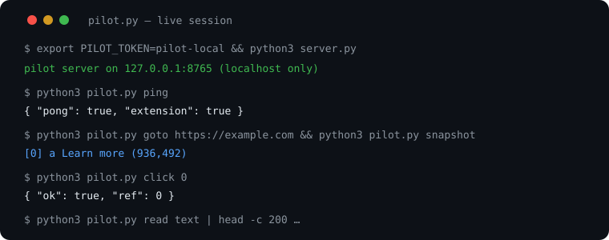
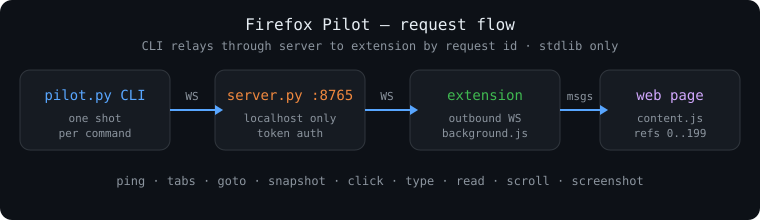

# 🦊 Firefox Pilot — local-only browser control for OpenCode

  

No AI inside. No API keys. No paid models. Stdlib-only server, plain-JS extension.
The brains are your existing free OpenCode models (Qwen3 8B local / Muse Spark Free).





## Layout

- `manifest.json` — MV2 + persistent background (keeps WS alive; MV3 event pages unload), Gecko ID, `connect-src` CSP for `ws(s)://127.0.0.1:8765`
- `background.js` — outbound WS client to `127.0.0.1:8765`, actions: ping/tabs/goto/snapshot/click/type/fill/upload/drop/read/scroll/screenshot
- `content.js` — per-page snapshot (refs, 📎 marks file inputs incl. hidden ones), trusted click/type events, batch fill, file upload + drop, text/html read
- `popup.html` — toolbar status (connected ○/●)
- `server.py` — stdlib-only WS server: localhost only, token auth, relays CLI↔extension by request id
- `pilot.py` — stdlib CLI client

## Run

```bash
export PILOT_TOKEN=pilot-local   # must match extension default (or set ext storage token)
python3 server.py
python3 pilot.py ping            # {"pong": true, "extension": true} when connected
```

## Load extension (Firefox ESR)

1. `about:debugging` → This Firefox → Load Temporary Add-on → pick `manifest.json`
2. Optional: set token — extension popup has no setter yet, so default `pilot-local`
   matches only if you export `PILOT_TOKEN=pilot-local` before starting server,
   or copy the generated token into extension storage via devtools console:
   `browser.storage.local.set({token: "<from ~/.config/firefox-pilot/token>"})`
3. `python3 pilot.py ping` → `"extension": true`

## Use

```bash
python3 pilot.py tabs
python3 pilot.py snapshot            # numbered refs (📎 = file input)
python3 pilot.py click 12
python3 pilot.py type 7 "hello" --submit
python3 pilot.py fill 7="hello" 9="World" 11=true   # text/select/checkbox in one call
python3 pilot.py upload 14 ~/Pictures/photo.png     # real local file -> <input type=file>
python3 pilot.py drop 20 ~/Pictures/photo.png       # real local file -> dropzone
python3 pilot.py read text
python3 pilot.py screenshot /tmp/opencode/pilot-shot.png
```

Notes:

- `upload`/`drop` send real file bytes over localhost; the page receives a genuine
  `File` (name + type + bytes), so LinkedIn/Gmail/Drive accept it. Max 8MB.
- `drop` fires synthetic dragenter/dragover/drop events — not OS-level dragging,
  but accepted by virtually all dropzones. No clipboard needed.
- `fill` auto-detects per ref: select (by value or visible text), checkbox/radio
  (`true/1/yes/on`), text, contenteditable. Per-field results, never half-throws.
- After pulling v0.3.0, reload the temporary add-on in `about:debugging` once.

## Security

- Binds 127.0.0.1 only. Token required (`?token=`). Wrong token → 403.
- Extension only connects out to localhost; no inbound ports, no remote hosts.
- Temporary add-on (unloaded on restart) — reload per session, by design.
